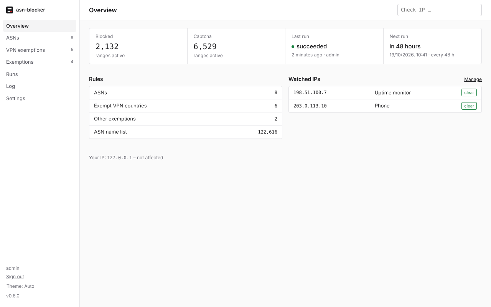
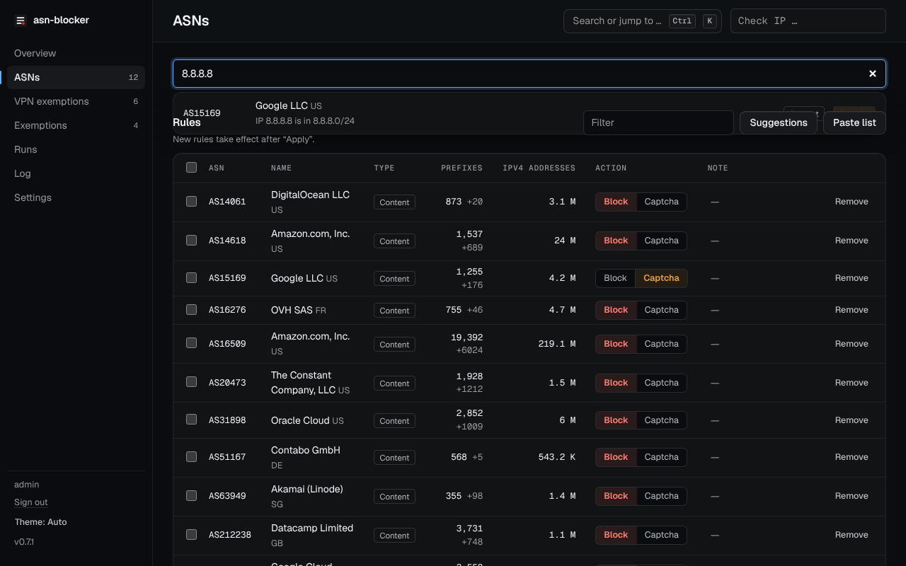
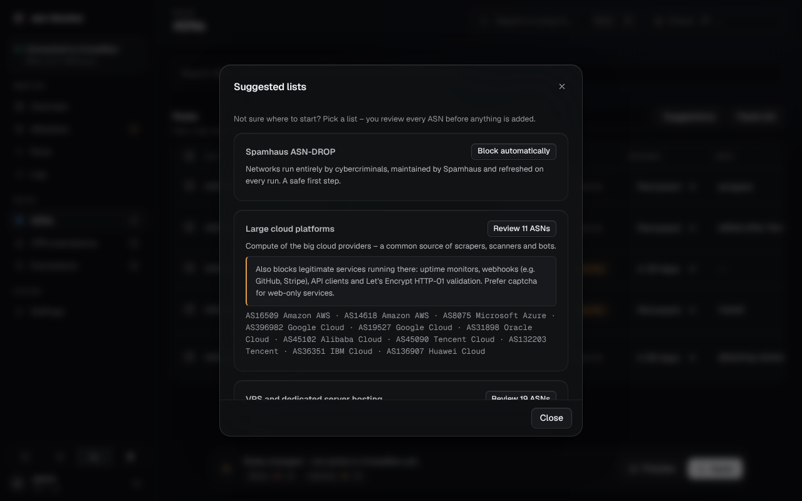
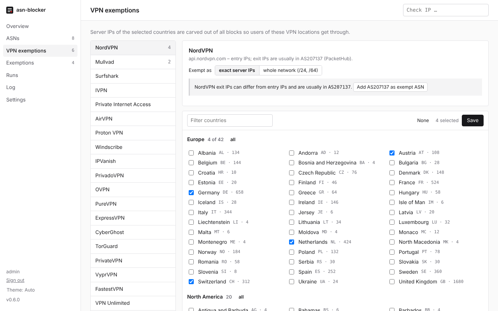
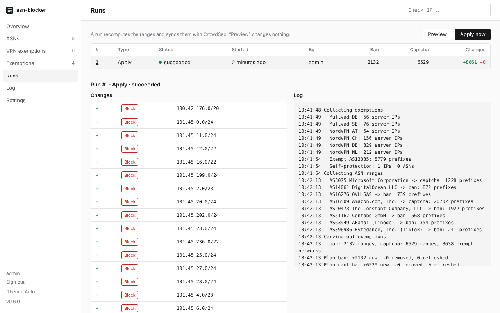

# asn-blocker

Block or captcha whole networks in [CrowdSec](https://crowdsec.net) by their **AS number** – and keep the IP ranges
up to date automatically.

Hosting providers and cloud networks are a common source of scrapers, credential stuffing and vulnerability scans.
Blocking them IP by IP never ends; blocking them by ASN (Autonomous System Number, e.g. `AS14061` for DigitalOcean)
catches every address the network announces. asn-blocker looks up the current prefixes of the ASNs you choose,
removes your exemptions and keeps the result in sync with CrowdSec as *ban* or *captcha* decisions.

- **Web UI** to search ASNs by number or name and choose *Block* or *Captcha* per ASN
- **Automatic refresh** of the ranges (every 48 h by default), with a preview of every change
- **Exemptions** for individual IPs/networks, whole ASNs, and the server locations of VPN providers
  (20 providers, including NordVPN, Proton VPN, Mullvad, Surfshark, ExpressVPN, PureVPN, CyberGhost, Windscribe and
  Private Internet Access) – so users on those VPNs are not blocked
- **Lockout protection** for your own connection and active SSH sessions
- **One container**, no Docker socket, no environment variables; everything is configured in the UI



## Contents

- [How it works](#how-it-works)
- [Requirements](#requirements)
- [Installation](#installation)
- [Accessing the web UI](#accessing-the-web-ui)
- [Using asn-blocker](#using-asn-blocker)
- [Safeguards](#safeguards)
- [Operations](#operations)
- [Troubleshooting](#troubleshooting)
- [Security](#security)
- [Development](#development)

## How it works

```
 your rules ──► announced prefixes ──► minus exemptions ──► sanity checks ──► CrowdSec LAPI ──► your bouncers
 (ASN + action)   (RIPEstat)            (IPs, ASNs, VPN)      (see Safeguards)   (ban / captcha)
```

1. For each ASN rule, asn-blocker fetches the prefixes the network currently announces (via [RIPEstat](https://stat.ripe.net)).
2. It cuts out all exemptions, then compares the result with what is active in CrowdSec.
3. It adds new ranges first and removes outdated ones afterwards, so protection never has a gap.
4. Decisions are created with a limited lifetime (7 days by default) and renewed by every run. If asn-blocker stops
   running, its decisions simply expire.

asn-blocker connects to CrowdSec's Local API (LAPI) as a *machine*, the same way a CrowdSec agent does. Your existing
bouncers (firewall, Traefik, nginx, …) enforce the decisions; nothing else in your setup changes.

## Requirements

- **CrowdSec** 1.6 or newer with its LAPI reachable from the container (tested with 1.8.1 and 1.8.2-rc1)
- **Docker** with Compose
- **A bouncer** that enforces the decisions. Note: *captcha* decisions only work with a bouncer that can show a
  captcha, such as the [Traefik plugin](https://plugins.traefik.io/plugins/6335346ca4caa9ddeffda116/crowdsec-bouncer-traefik-plugin)
  or the nginx/OpenResty bouncer. Firewall bouncers (nftables/iptables) ignore captcha decisions.
- **Recommended: a reverse proxy with single sign-on** (e.g. Pangolin, Authentik, Authelia) in front of the UI
- Outbound HTTPS from the container to stat.ripe.net, bgp.tools and – if used – the VPN provider APIs and spamhaus.org

## Installation

### 1. Create credentials in CrowdSec

asn-blocker needs its own machine account in CrowdSec. Run this once and note the printed password:

```bash
docker exec crowdsec cscli machines add asn-blocker --auto -f -
```

### 2. Add the container

```yaml
services:
  asn-blocker:
    image: ghcr.io/larosen/asn-blocker:latest
    container_name: asn-blocker
    restart: unless-stopped
    volumes:
      - asn-blocker-data:/data
      - /run/systemd/sessions:/host/sessions:ro   # optional: protect active SSH sessions, see "Lockout protection"
    networks:
      - crowdsec                           # a network in which the CrowdSec container is reachable
    # Hardening – the app needs none of the dropped privileges
    read_only: true
    tmpfs:
      - /tmp:size=16m,noexec,nosuid,nodev
    cap_drop: [ALL]
    security_opt: [no-new-privileges:true]
    mem_limit: 256m
    pids_limit: 128

volumes:
  asn-blocker-data:

networks:
  crowdsec:
    external: true                         # use the name of your existing network
```

The container listens on port `8080` inside the Docker network. **Do not publish it with `ports:`** – see
[Accessing the web UI](#accessing-the-web-ui).

```bash
docker compose up -d asn-blocker
docker logs asn-blocker 2>&1 | grep -i "setup token"
```

The log shows a one-time **setup token**. It is needed for the first visit and becomes invalid once setup is done.

### 3. First setup in the browser

1. Open the UI (see next section) and enter the setup token.
2. Choose how users sign in: through your reverse proxy with SSO, or with the built-in password login.
3. Under **Settings → CrowdSec connection**, enter the LAPI URL (usually `http://crowdsec:8080`), the machine ID
   `asn-blocker` and the password from step 1.
4. Under **Exemptions → Self-protection**, protect your own connection (see [Lockout protection](#lockout-protection)).
5. Under **ASNs**, add your first rules, check **Preview**, then click **Apply**.

## Accessing the web UI

The UI can change what your server blocks, so it should not be reachable from the internet without authentication.
Docker-published ports also bypass host firewalls such as UFW. Therefore the container has no published port; it is
reached through the Docker network.

### Behind a reverse proxy with SSO (recommended)

1. Attach asn-blocker to a Docker network your reverse proxy can reach, and point a route or resource at
   `http://asn-blocker:8080` with authentication enabled.
2. Open the UI through that route and choose **Reverse proxy with SSO** during setup:
   - **Trusted proxy IPs** – pre-filled with the address the request came from, i.e. your proxy. Keep it to that
     single address. Everything in a trusted range may send any username, so never trust a whole shared Docker network.
   - **Header with username** – the header your proxy sets after a successful login. Use a header the proxy always
     strips from incoming requests and sets itself:
     - **Pangolin:** `Remote-User` (Badger 1.2.1 or newer removes client-supplied `Remote-*` headers)
     - **Authentik / Authelia forward auth:** the user header listed in the middleware's `authResponseHeaders`,
       e.g. `X-authentik-username` or `Remote-User`

Setup checks that the current request actually meets these conditions, so you cannot lock yourself out by a typo.
Requests that carry the username header twice are rejected. Do not add unauthenticated bypass rules for this route.

If the proxy container gets a new IP address after being recreated, sign-in stops working; run
`docker exec asn-blocker python -m app.cli reset-auth` and repeat the setup (or give the proxy a fixed IP).

### Built-in login

Without an SSO proxy, choose **Built-in login**: a username and a password of at least 12 characters, a session cookie
valid for 12 hours, and throttling after 5 failed attempts. Put the UI behind a TLS-terminating reverse proxy anyway.

### Temporary access through an SSH tunnel

For testing without a proxy, publish the port on localhost only and tunnel to it:

```yaml
    ports: ["127.0.0.1:18080:8080"]        # any free host port on the left
```

```bash
ssh -L 18080:127.0.0.1:18080 user@your-server   # then open http://localhost:18080
```

Choose **Built-in login** in this case – the proxy mode can only be set up through the proxy itself.

## Using asn-blocker

### ASN rules

Under **ASNs**, search by number (`14061`, `AS14061`), by name (`digitalocean`) or by **IP address** and set **Block**
or **Captcha**. An IP – for example from a CrowdSec alert – shows the network that announces it; if no network
announces it, the search says so and names the registered holder. The name search uses a local copy of the
[bgp.tools](https://bgp.tools) ASN list, refreshed weekly. The **Check IP** field at the top offers the same buttons.



Not sure where to start? **Suggestions** offers curated lists (large cloud platforms, VPS and dedicated hosting,
ByteDance crawlers) and Spamhaus ASN-DROP. Each list says what else it blocks, and every ASN is shown for review
before anything is added.



Adding a rule for the network you are currently connected from asks for an explicit confirmation – useful when you
deliberately want to block, say, a hotel or office network.

To add many at once, use **Paste list**: one ASN per line, optionally followed by a comment, which is kept as a note.
Lines starting with `#` are skipped.

```
AS14061  # DigitalOcean
16509      Amazon AWS
# 13335    Cloudflare – skipped
```

Rule changes take effect with the next run. Click **Apply** to run now, or wait for the schedule.

### Exemptions

Exemptions are cut out of every blocked range.

- **Exemptions → IPs and networks** – single addresses or CIDRs, e.g. a partner's server.
- **Exemptions → Exempt ASNs** – entire networks that must never be blocked.
- **VPN exemptions** – pick a provider and the countries whose servers should stay reachable. asn-blocker loads the
  provider's public server list and exempts exactly those server IPs. Optionally the surrounding `/24` (IPv6 `/64`)
  can be exempted instead; this is broader and may also exempt other servers at the same hosting provider.
  Note: some VPNs use different addresses for incoming and outgoing traffic. NordVPN's outgoing IPs are mostly in
  `AS207137`, which you can add as an exempt ASN.
  Sources: the providers' own server lists for NordVPN, Mullvad, Surfshark, IVPN, Private Internet Access, AirVPN,
  Windscribe, IPVanish (with the gluetun data as fallback when IPVanish refuses the download), PrivadoVPN and
  OVPN; Proton VPN's exit IPs from the daily
  [ProtonVPN-IPs](https://github.com/tn3w/ProtonVPN-IPs) list; PureVPN, ExpressVPN, CyberGhost, TorGuard, PrivateVPN,
  VyprVPN, FastestVPN, VPN Unlimited and VPNSecure from the [gluetun](https://github.com/qdm12/gluetun-servers)
  project's server data (updated about monthly), as these providers publish no list of their own.



### Lockout protection

A firewall bouncer applies bans to *all* traffic, including SSH. To keep you from locking yourself out:

- **Active SSH sessions** are detected automatically when the host's session registry is mounted read-only:
  `/run/systemd/sessions:/host/sessions:ro` on any system with systemd (as in the compose file), or
  `/var/run/utmp:/host/utmp:ro` on systems without systemd-logind. Some current distributions no
  longer have a utmp file. The IPs of these sessions are never blocked. **Exemptions → Self-protection** shows whether
  sessions are detected.
- **Protected IPs and ASNs** (Exemptions → Self-protection) are never blocked, not even through Spamhaus or a confirmed
  run. Rules for protected ASNs are rejected. Home connections usually change their IP, so protect the **ASN** of
  your internet provider. From an SSH session, one command does this:
  ```bash
  docker exec -e SSH_CLIENT asn-blocker python -m app.cli protect          # IP and ASN of this SSH connection
  docker exec asn-blocker python -m app.cli protect --list                  # show what is protected
  ```
- The **Overview** warns if the IP you are browsing from is affected by a block, with a one-click exemption.
- Before writing anything, every run checks that no protected IP would be blocked, and aborts otherwise.

### Watched IPs and notifications

Add IPs that must stay reachable – your phone, monitoring, a customer – under **Exemptions → Watched IPs**. After
every run they are checked; if one would be affected, you get a notification.

Notifications are sent when a run fails, when the sanity check stops a run, and when a watched IP is affected.
Configure them under **Settings → Notifications** for [ntfy](https://ntfy.sh), [Gotify](https://gotify.net) or a JSON
webhook. **Send test** checks the values before they are saved and reports the server's answer, e.g. a rejected
token; **Save** is only possible after a successful test. Each notification links to the run it is about.

**ntfy with access control** (recommended for self-hosted ntfy with `auth-default-access: deny-all`):

```bash
docker exec ntfy ntfy user add asn-blocker                       # password is not needed afterwards
docker exec ntfy ntfy access asn-blocker asn-blocker write-only   # user, topic, permission
docker exec ntfy ntfy token add asn-blocker                      # prints tk_…
docker exec ntfy ntfy access <your-user> asn-blocker read-only    # the account your phone subscribes with
```

In asn-blocker: URL `https://ntfy.example.com/asn-blocker`, format *ntfy*, access token `tk_…`. The token is sent as
`Authorization: Bearer` header, is never shown again, and is discarded if the URL is changed to a different server.
If ntfy runs on the same Docker network, the internal address (e.g. `http://ntfy:80/asn-blocker`) avoids the detour
through the reverse proxy – an SSO-protected proxy route would reject the request.

For **Gotify**, use `https://gotify.example.com/message` and the application token as access token.

### Spamhaus ASN-DROP

Optionally, the [Spamhaus ASN-DROP](https://www.spamhaus.org/blocklists/do-not-route-or-peer/) list – networks run
entirely by cybercriminals – can be included as an additional set of ASN rules (**Settings → Schedule and safety**).

### Checking an IP

The **Check IP** field at the top of every page shows, for any IP, its ASN and prefix, whether it is currently
blocked, and which rule or exemption applies – with buttons to block its network or put it behind a captcha.

## Safeguards

| | |
|---|---|
| **Validate before writing** | If a data source fails or returns invalid data, the run aborts and CrowdSec stays unchanged. |
| **Sanity check** | If the number of ranges or the blocked IPv4 or IPv6 address space changes by more than 30 % (configurable) – e.g. after adding many ASNs or enabling IPv6 – the run stops and a dialog shows why. **Apply anyway** applies exactly the reviewed result; if the data changed meanwhile, the run stops again. Hard limits apply even to the first run: 150,000 ranges, 2^29 IPv4 addresses and 2^36 IPv6 /48 networks. |
| **Implausible data is ignored** | Private and reserved ranges are never blocked; prefixes larger than /8 (IPv6 /16) are discarded. |
| **No gaps** | New ranges are added before outdated ones are removed. |
| **Decisions expire** | Decisions last 7 days (configurable) and are renewed by every run, so nothing lingers if asn-blocker is removed. |
| **Own decisions only** | asn-blocker only changes decisions it created itself (reason `asn-blocker ban` / `asn-blocker captcha` and its own alert source). Decisions of other tools and CrowdSec's own detections are never touched. |
| **Preview** | **Preview** shows exactly what a run would add and remove, without changing anything. |

Every run, with its log and all changes, is kept under **Runs**; every configuration change is recorded under **Log**.



## Operations

### Settings

Configured in the UI under **Settings → Schedule and safety**:

| Setting | Default | |
|---|---|---|
| Update every | 48 h | How often ranges are refreshed (6 h – 14 days) |
| Decision lifetime | 7 days | Lifetime of each decision; must be at least twice the interval |
| Also block IPv6 prefixes | off | IPv4 only by default |
| Sanity limit | 30 % | Maximum change before a run needs confirmation |
| Spamhaus ASN-DROP | off | Include the list as *Block* or *Captcha* |

Optional environment variables: `LOG_FORMAT=json` (structured logs, e.g. for Loki), `LOG_LEVEL=DEBUG`.

### Data and backup

All state lives in the volume mounted at `/data` (a single SQLite database with rules, run history, audit log and
CrowdSec credentials). Back up that volume, or use **Settings → Maintenance → Export configuration** for the rules and
exemptions alone. The same page imports an export and offers the active ranges as plain text.

### Updates

```bash
docker compose pull asn-blocker && docker compose up -d asn-blocker
```

`:latest` is only published after the image passed a vulnerability scan, so automatic updaters such as Watchtower can
follow it. To pin a build, use a release tag (e.g. `:0.6.0`) or the immutable `:sha-<commit>` tag every build gets.
Changes are listed in the [changelog](CHANGELOG.md).

### Command line

```bash
docker exec asn-blocker python -m app.cli reset-auth        # forgot the password / proxy changed: prints a new setup token
docker exec asn-blocker python -m app.cli protect [IP]      # protect an IP and its ASN (see Lockout protection)
docker exec asn-blocker python -m app.cli check-sources     # test all external data sources
```

### Removing decisions of other tools

If you previously blocked networks with another script via `cscli`, you can remove those decisions by their reason
under **Settings → Maintenance**. Only decisions added via `cscli` are affected; CrowdSec's own detections and
blocklists are never touched.

### Uninstalling

Remove all rules and run **Apply** (the sanity check asks for confirmation with **Apply anyway**) to delete
asn-blocker's decisions immediately – or simply remove the container; its decisions expire after the configured
decision duration. Then delete the machine in CrowdSec:
`docker exec crowdsec cscli machines delete asn-blocker`.

## Troubleshooting

| Problem | Solution |
|---|---|
| No setup token in the log | Setup is already done. To start over: `docker exec asn-blocker python -m app.cli reset-auth` |
| "Not signed in" behind the proxy | The proxy's IP changed or it does not send the username header – see [Behind a reverse proxy](#behind-a-reverse-proxy-with-sso-recommended) |
| "LAPI not reachable" | asn-blocker and CrowdSec must share a Docker network; use the container name in the URL (`http://crowdsec:8080`) |
| "LAPI login failed" | Wrong machine ID or password; create new credentials with `cscli machines add` |
| Run stopped by the sanity check | The dialog, the banner and the run under **Runs** show the reason; click **Apply anyway** if the change is expected |
| Captcha has no effect | Your bouncer cannot show captchas (firewall bouncers can't) |
| "Active SSH sessions: not available" | The session registry is not mounted – add `/run/systemd/sessions:/host/sessions:ro` and recreate the container with `docker compose up -d` |
| Surfshark countries fail | Surfshark only publishes hostnames; the container needs working DNS |
| Locked out via SSH | From the host console: `docker exec asn-blocker python -m app.cli protect <your-ip>`, then **Apply** – or remove the decision with `cscli decisions delete --ip <your-ip>` |

## Security

asn-blocker can change what your server blocks; treat access to it like access to CrowdSec itself. All signed-in users
have full rights. See [SECURITY.md](SECURITY.md) for the threat model, the hardening built into the image and how to
report vulnerabilities.

**Network isolation:** asn-blocker only needs to reach the CrowdSec LAPI and to be reached by your proxy. If your
proxy network also hosts other services (dashboards, identity provider, admin APIs), consider two dedicated networks
instead – one shared with the proxy only and one shared with CrowdSec only:

```bash
docker network create asnb-proxy && docker network connect asnb-proxy <proxy-container>
docker network create asnb-lapi  && docker network connect asnb-lapi crowdsec
```

Then attach asn-blocker to `asnb-proxy` and `asnb-lapi` (both `external: true`). Re-run the `connect` commands when
those containers are recreated.

**Legacy Docker socket mode:** if the LAPI cannot be reached, asn-blocker can instead run `cscli` in the CrowdSec
container through the Docker socket (**Settings → CrowdSec connection**). This requires mounting
`/var/run/docker.sock`, which gives anyone controlling the app root access to the host. Prefer the LAPI.

## Development

```bash
pip install --require-hashes --no-deps -r requirements.txt && pip install -r requirements-dev.txt
ruff check app tests && pytest -q
DATA_DIR=./data uvicorn app.main:app --reload --port 8080
```

- Backend: FastAPI and SQLite (`app/`); frontend: plain HTML/CSS/JavaScript without a build step (`app/static/`).
- Integration test against a real LAPI: set `CROWDSEC_LAPI_URL`, `CROWDSEC_MACHINE_ID` and `CROWDSEC_PASSWORD`, then
  run `pytest tests/test_lapi_integration.py`. CI runs it against CrowdSec 1.8.1 on every push.
- Dependencies: direct pins in `requirements.in`; `requirements.txt` is the hash-locked set, generated with
  `uv pip compile requirements.in --universal --python-version 3.14 --generate-hashes -o requirements.txt`.

## License

[MIT](LICENSE)
