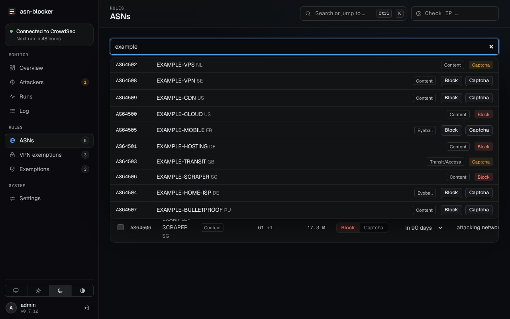
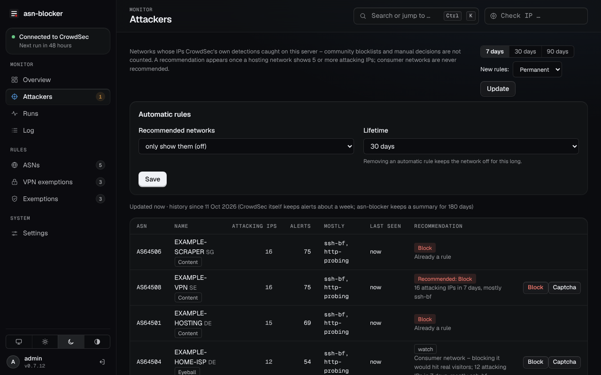
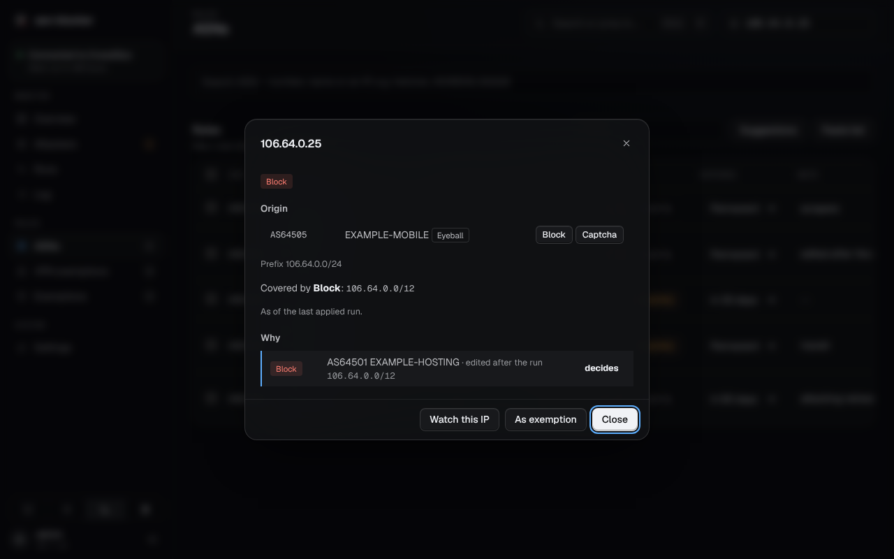
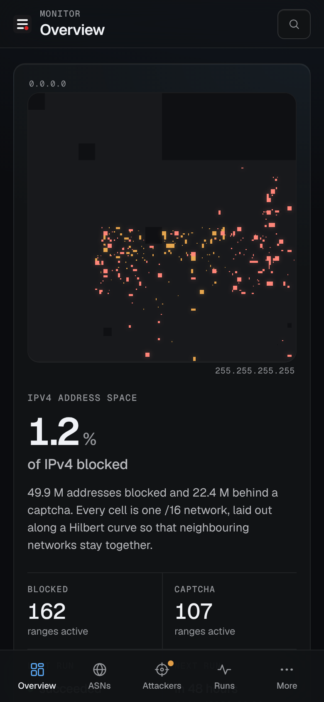

# asn-blocker

asn-blocker blocks whole networks in [CrowdSec](https://crowdsec.net) by their AS number. You pick the networks
(for example the hosting providers your scrapers and scanners come from), asn-blocker looks up every IP range they
announce, leaves out what you exempt, and keeps the result in CrowdSec as *ban* or *captcha* decisions. The ranges are
refreshed automatically, so new addresses of a network are covered without you doing anything.


## What you need first

asn-blocker does not block anything itself. It writes decisions into CrowdSec, and a bouncer enforces them.

| | What for | Where |
|---|---|---|
| **CrowdSec Security Engine** 1.6 or newer | Stores the decisions. asn-blocker connects to its Local API (LAPI). | [crowdsecurity/crowdsec](https://github.com/crowdsecurity/crowdsec) |
| **At least one bouncer** | Enforces the decisions. Without a bouncer, nothing is blocked. | see below |
| **Docker** with Compose | Runs asn-blocker. | [docs.docker.com](https://docs.docker.com/engine/install/) |
| Reverse proxy with single sign-on (recommended) | Puts a login in front of the web UI. Pangolin, Authentik or Authelia, for example. | [fosrl/pangolin](https://github.com/fosrl/pangolin), [goauthentik/authentik](https://github.com/goauthentik/authentik), [authelia/authelia](https://github.com/authelia/authelia) |

Which bouncer you need depends on what you want to block:

| Bouncer | Ban | Captcha |
|---|---|---|
| [Firewall bouncer](https://github.com/crowdsecurity/cs-firewall-bouncer) (nftables/iptables) | all traffic, including SSH | no |
| [Traefik plugin](https://github.com/maxlerebourg/crowdsec-bouncer-traefik-plugin) | web traffic | yes |
| [nginx bouncer](https://github.com/crowdsecurity/cs-nginx-bouncer) or [OpenResty bouncer](https://github.com/crowdsecurity/cs-openresty-bouncer) | web traffic | yes |

Captcha needs a bouncer that can show one, configured with a captcha provider (Turnstile, hCaptcha or reCAPTCHA).
A firewall bouncer ignores captcha decisions.

The container also needs outbound HTTPS to bgp.tools (routing table), stat.ripe.net (fallback) and, if you use
them, the VPN providers' server lists and spamhaus.org.

## How it works

```
your rules ─► announced prefixes ─► minus exemptions ─► sanity checks ─► CrowdSec LAPI ─► your bouncers
```

1. Once a day asn-blocker loads a copy of the global routing table from [bgp.tools](https://bgp.tools) (about 80 MB)
   and reads from it which prefixes each of your networks announces.
2. It removes your exemptions: single IPs and networks, whole ASNs, the servers of VPN providers you allow, and your
   own connection.
3. It compares the result with what is active in CrowdSec, adds new ranges first and removes outdated ones afterwards.
4. Every decision has a lifetime (7 days by default) and is renewed before it runs out. If you stop asn-blocker, its
   decisions expire on their own.

asn-blocker logs in to the LAPI as a *machine*, the same way a CrowdSec agent does. It only touches decisions it
created itself. Your existing bouncers, scenarios and blocklists stay as they are.

## Installation

**1. Create a machine account in CrowdSec** and note the password it prints:

```bash
docker exec crowdsec cscli machines add asn-blocker --auto -f -
```

**2. Add the container** to your compose file. It has to share a Docker network with CrowdSec:

```yaml
services:
  asn-blocker:
    image: ghcr.io/larosen/asn-blocker:latest
    container_name: asn-blocker
    restart: unless-stopped
    volumes:
      - asn-blocker-data:/data
      - /run/systemd/sessions:/host/sessions:ro   # optional: never block your active SSH sessions
    networks:
      - crowdsec                                  # the network your CrowdSec container is in
    read_only: true
    tmpfs:
      - /tmp:size=16m,noexec,nosuid,nodev
    cap_drop: [ALL]
    security_opt: [no-new-privileges:true]
    mem_limit: 256m
    pids_limit: 128

volumes:
  asn-blocker-data:

networks:
  crowdsec:
    external: true
```

```bash
docker compose up -d asn-blocker
docker logs asn-blocker 2>&1 | grep -i "setup token"
```

The web UI listens on port 8080 inside the Docker network. Don't publish it with `ports:`, reach it through your
reverse proxy instead (point a route with authentication at `http://asn-blocker:8080`). For a first test without a
proxy, an SSH tunnel works too: see [docs/access.md](docs/access.md).

**3. Set it up in the browser.** Open the UI and enter the setup token from the log. Then:

1. Choose how you sign in: through your reverse proxy, or with a username and password.
2. **Settings → CrowdSec connection**: LAPI URL (usually `http://crowdsec:8080`), machine ID `asn-blocker` and the
   password from step 1.
3. **Exemptions → Self-protection**: protect the IP you are connecting from, so you cannot lock yourself out.
4. **ASNs**: add your first networks, click **Preview** to see what would change, then **Apply**.

If CrowdSec runs directly on the host rather than in Docker, its LAPI has to listen on an address the container can
reach (`api.server.listen_uri` in CrowdSec's `config.yaml`).

## Using it

### Choosing networks

Under **ASNs** you search by number (`AS14061`), by name (`digitalocean`) or by an IP address from an alert, and set
each network to **Block** or **Captcha**. A rule can be permanent or expire after 7, 30, 90 days or a year.
**Paste list** takes many ASNs at once, **Suggestions** offers ready-made lists such as the large cloud platforms,
each with a note on what else it would block.



### Exemptions and VPN users

Exemptions are cut out of every blocked range: single IPs or networks, whole ASNs, and the servers of VPN
providers. For a VPN you pick the provider and the countries, and asn-blocker keeps their server IPs reachable.
20 providers are supported, among them NordVPN, Proton VPN, Mullvad, Surfshark and ExpressVPN.


### Attackers

**Attackers** lists the networks behind the IPs your own CrowdSec caught on this server, over 7, 30 or 90 days.
Hosting networks with 5 or more attacking IPs get a recommendation that you can add with one click. Consumer
networks are never recommended. If you want, recommended networks can also be added automatically, with a lifetime.



### Checking an IP

The **Check IP** field at the top shows for any address which network it belongs to, whether it is blocked, and
which rule decides. That is useful when a visitor reports they cannot reach your site.



### Runs and history

Every run is kept with the ranges it added or removed and its log. Every configuration change is recorded under
**Log**. Notifications for failed runs, stopped runs and affected watched IPs can go to ntfy, Gotify or a webhook
([docs/notifications.md](docs/notifications.md)).


The UI works on phones as well.



## Safety

- If a data source fails or returns something implausible, the run stops and CrowdSec stays unchanged.
- If a run would change the number of ranges or the blocked address space by more than 30 %, it stops and asks
  you first.
- Private and reserved ranges are never blocked. Neither are your protected IPs or your active SSH sessions.
- **Preview** shows exactly what a run would add and remove, without changing anything.

More on lockout protection, the sanity check and how rules work together: [docs/rules.md](docs/rules.md).

## Updating and removing

```bash
docker compose pull asn-blocker && docker compose up -d asn-blocker
```

`:latest` is only published after the image passed a vulnerability scan. To pin a version, use a release tag such as
`:0.7` or `:0.7.12`. All state is in the `/data` volume; back it up, or export the rules under
**Settings → Maintenance**.

To remove asn-blocker, delete the container. Its decisions expire after their lifetime (7 days by default). To remove
them at once, delete all rules and run **Apply** first. Then remove the machine in CrowdSec:
`docker exec crowdsec cscli machines delete asn-blocker`.

## Troubleshooting

| Problem | Fix |
|---|---|
| No setup token in the log | Setup is already done. To start over: `docker exec asn-blocker python -m app.cli reset-auth` |
| "No access" behind the proxy | The page shows where the request came from. Trust that proxy: `docker exec asn-blocker python -m app.cli trust-proxy <name>`. See [docs/access.md](docs/access.md). |
| "LAPI not reachable" | asn-blocker and CrowdSec need a shared Docker network. Use the container name in the URL. |
| "LAPI login failed" | Wrong machine ID or password. Create new credentials with `cscli machines add`. |
| Captcha has no effect | Your bouncer cannot show captchas (firewall bouncers can't). |
| Locked out via SSH | From the host console: `docker exec asn-blocker python -m app.cli protect <your-ip>`, then **Apply**. Or `cscli decisions delete --ip <your-ip>`. |

## More

- [docs/access.md](docs/access.md): reverse proxy and SSO, built-in login, SSH tunnel, network isolation
- [docs/rules.md](docs/rules.md): lockout protection, VPN sources, Spamhaus ASN-DROP, how rules combine, safeguards
- [docs/notifications.md](docs/notifications.md): ntfy, Gotify, webhooks
- [docs/operations.md](docs/operations.md): settings, backup, versions, command line
- [SECURITY.md](SECURITY.md), [CHANGELOG.md](CHANGELOG.md), [CONTRIBUTING.md](CONTRIBUTING.md)

## License

[MIT](LICENSE). Bundled: Geist fonts ([OFL](app/static/fonts/OFL-Geist.txt)), [Preact](app/static/vendor/LICENSE-preact)
(MIT) and [htm](app/static/vendor/LICENSE-htm) (Apache-2.0).
